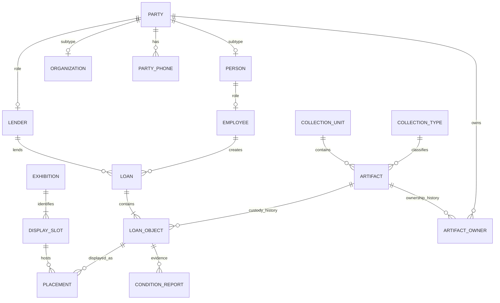
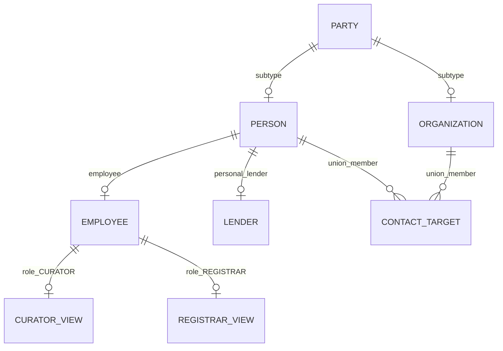
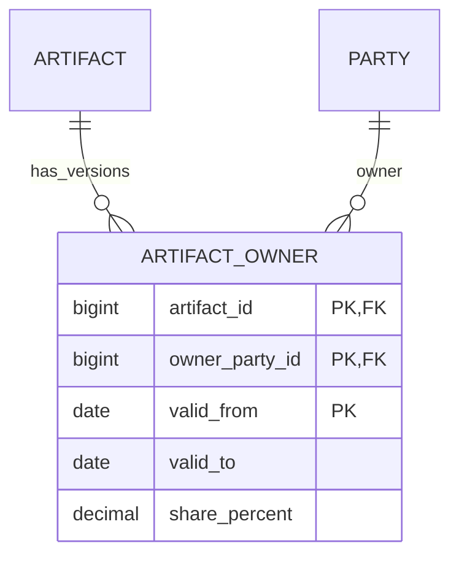

# ER/EER diagrams – Meridian Museum

## Preferred ER model

## EER roles

EMPLOYEE has a role discriminator: CURATOR, REGISTRAR or SUPPORT. Roles are disjoint in this implementation; the specialization is partial if support staff exist. A curator who lends privately uses the same PERSON identity for employee and lender roles. CONTACT_TARGET is a union/category over PERSON and ORGANIZATION; each row points to exactly one subtype.

## Changed ownership history

Example: artifact A-10 has P1 60% and P2 40% from Jan 1 to Jun 30. From Jul 1, P1 has 50%, P2 30%, P3 20%. The loan custody interval may span this ownership change and remains unchanged.

## Chen notation legend
- Rectangle: strong entity; double rectangle: weak entity DISPLAY_SLOT.
- Diamond: relationship; double diamond: identifying relationship EXHIBITION–DISPLAY_SLOT.
- Underlined attribute: primary key; slot_no is the weak entity's partial key.
- Dashed oval: derived attribute; double oval: multivalued attribute.
- Composite oval: person name decomposed into given/middle/family.
- ISA triangle: specialization/generalization.
- Double line: total participation; single line: optional participation.
- DISPLAY_SLOT full key is (exhibition_id, slot_no). Slot numbers are not globally unique.
- PLACEMENT references the composite slot key, not slot_no alone.
